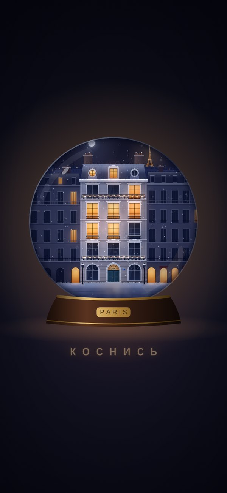
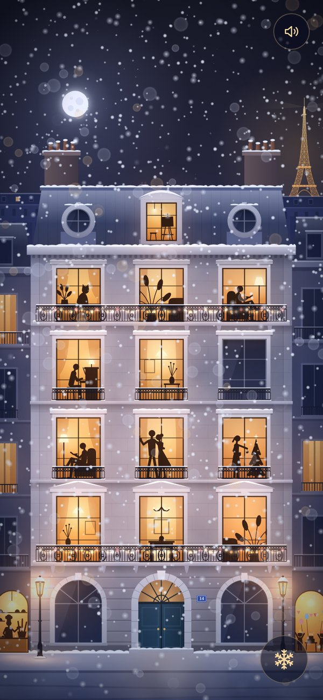

# Snow Globe

*let it snow*

A tiny Parisian evening inside a glass globe.
Tap to fly in, light up the windows, shake the snow.

**[▶ Open it](https://vshgit.github.io/snow-globe/)** · best on a phone, with sound on

 &nbsp; 

## Why

My husband and I sometimes dance at home in the evening, and I like to imagine that this is how we look to our neighbours: two silhouettes in a warm window.
So I built a whole house of little lives like that, and put it in a snow globe.

## Things to try

- **Windows:** tap to switch the light on or off. Someone is always living there: a couple dancing, a pianist, a cat, someone reading, someone decorating a tree.
- **Snow:** shake your phone, or hold the snowflake button. On a computer, drag the mouse fast.
- **Street lamps, shop windows, the front door:** tap them too.
- **A few secrets:** the moon, the Eiffel Tower and the chimneys.

The house also lives on its own: lights go on and off, and sometimes someone steps out onto a balcony to watch the snow.

## How it's made

- One self-contained HTML file. No images, no libraries: everything is drawn in code on a 2D canvas.
- Thousands of snowflakes with depth and bokeh, and a camera that flies from the globe into the street.
- The jazz is not a recording: it is synthesized live in the browser with the Web Audio API.
- Shake detection works with the phone's motion sensors.
- The page lowers its resolution by itself on slower phones to keep the animation smooth.

Made in an evening with AI-assisted coding.
